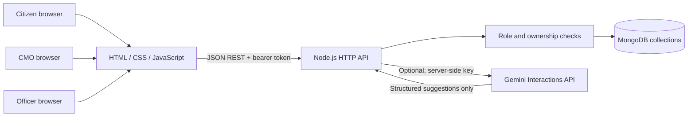

# System architecture

The browser UI is a small single-page application served by the Node.js process. It calls same-origin JSON REST endpoints. The API applies role and record ownership checks before returning private grievance data or attachments. The server persists users, departments, grievances, status history, assignments, escalations, attachment metadata and bytes, feedback and enquiries in MongoDB collections.

## Security boundaries

- Passwords are scrypt hashes; API secrets are read from server environment variables.
- A citizen sees their own records. An officer sees records assigned to their department. The CMO administrator sees all grievances.
- Attachment downloads pass the same record-access checks as grievance detail. File bytes are stored in their own MongoDB collection.
- User text is escaped before insertion into the HTML interface; attachments have a MIME allowlist and a 3 MB size limit.
- Bearer tokens are signed with `SESSION_SECRET` and expire after eight hours. Signing out removes the token from the browser; a copied token remains valid until expiry. Add durable sessions, CSRF protections appropriate to the chosen auth mechanism, rate limiting, logging and deployment hardening before production use.

The prototype currently runs as one Node service instance with signed eight-hour bearer tokens. See [Database Design](03_Database_Design.md), [API Documentation](04_API_Documentation.md) and [AI Integration](05_AI_Integration.md).
