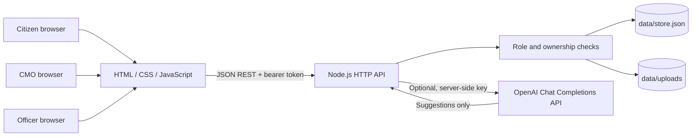

# System architecture

The browser UI is a small single-page application served by the Node.js process. It calls same-origin JSON REST endpoints. The API applies role and record ownership checks before returning private grievance data or attachments. The server writes users, departments, grievances, status history, assignments, escalations, attachment metadata, feedback and enquiries to separate collections in a local JSON store, and uploaded bytes to a separate uploads directory.

## Security boundaries

- Passwords are scrypt hashes; API secrets are read from server environment variables.
- A citizen sees their own records. An officer sees records assigned to their department. The CMO administrator sees all grievances.
- Attachment downloads pass the same record-access checks as grievance detail.
- User text is escaped before insertion into the HTML interface; uploaded filenames are reduced to a basename and stored under a generated server filename.
- Bearer sessions are in-memory demo sessions and are lost on server restart. Add durable sessions, CSRF protections appropriate to the chosen auth mechanism, rate limiting, logging and deployment hardening before production use.

See [Database Design](03_Database_Design.md), [API Documentation](04_API_Documentation.md) and [AI Integration](05_AI_Integration.md).
