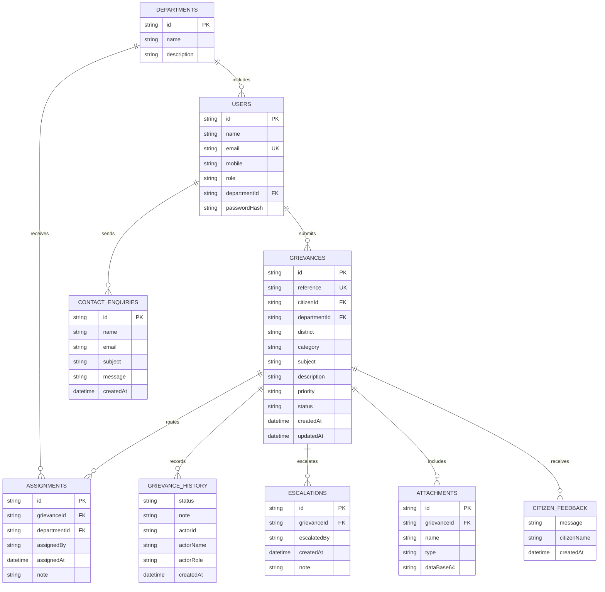

# Database design

The application uses MongoDB collections through the official Node.js driver. Seed accounts and sample grievances are fictional. The diagram describes the collection relationships; each collection stores documents with a stable string `id`.

Grievance documents retain a snapshot of status history for convenient reads; the canonical events are also stored in `grievanceHistory`. A grievance stores attachment metadata and references a separate `attachments` document containing the base64 file bytes (maximum 4 MB upload, within MongoDB's BSON document limit). Status timestamps use ISO 8601 strings. Unique indexes protect account emails and grievance references; additional indexes support ownership, department and history lookups.

The demo currently keeps a single in-memory view of records and flushes changes to MongoDB. Run one app instance to avoid stale in-memory data. A production version should use per-request database operations, durable sessions, GridFS or object storage for larger uploads, and backup/retention policies.
