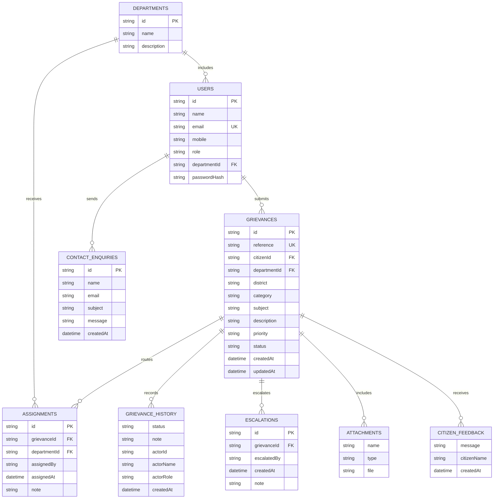

# Database design

The demo uses a JSON document store so it runs without database installation. The equivalent relational entities and relationships are shown below. Seed accounts and sample grievances are fictional.

Each grievance embeds its history, optional attachment metadata, action-taken report, CMO response and citizen feedback. `data/store.json` contains top-level arrays for users, departments, grievances and enquiries. Upload bytes are separate files in `data/uploads/`; file names are random server-generated identifiers. The application stores timestamps as ISO 8601 strings.

For a multi-instance or production deployment, move records and file metadata to a managed database and object store, add indexes for references/ownership/status, and define retention and backup policies.
